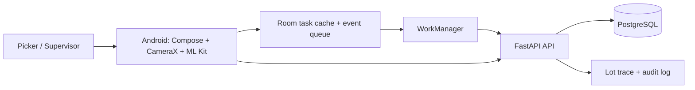

# PickSure

**Freshness-first grocery fulfillment for quick-commerce dark stores.** PickSure helps store teams pick the right product, choose a dispatchable expiry lot, and keep work safe when the network drops.

The differentiator is **Freshness First**: a picker scans the product barcode and its lot QR. The API recommends the earliest-expiring lot that still meets the store's shelf-life rule (FEFO), blocks lots that are expired or too close to expiry, and records the selected lot with the pick. Supervisors can see safe, held-back, and expired inventory in the freshness monitor.

> Portfolio project inspired by quick-commerce operations. It uses seeded demo data and is not connected to Blinkit or a live warehouse.

## Demo scope in numbers

| Seeded demo metric | Count |
| --- | ---: |
| Orders | 3 |
| Order lines | 6 |
| Grocery SKUs | 5 |
| Inventory lots | 10 (2 per SKU) |
| Starting inventory | 60 units |
| Dispatchable at seed | 50 units |
| Held back under the 3-day policy | 10 units |
| Employee roles | 2 (picker and supervisor) |
| Scans required per pick | 2 (product barcode + lot QR) |

These values describe the seeded sample only. They are implementation scope, not measured production improvements or customer outcomes.

## Why it matters

Quick-commerce teams must fulfill orders accurately while working against short delivery windows. A wrong SKU creates a customer issue; a short-dated grocery can arrive with little usable shelf life; a network interruption can lose work if picks exist only on the server.

PickSure addresses those risks with barcode checks, FEFO lot selection, a configurable minimum shelf-life rule, and a durable offline event queue. Held-back stock remains visible for store staff to review for markdown or donation before expiry.

## Core workflow

1. Sign in as a picker and open the assigned batch.
2. Follow the combined aisle, rack, and shelf route.
3. Scan the product barcode. A mismatch is rejected without creating a pick.
4. Scan the recommended lot QR. PickSure shows its lot code and expiry, then saves the pick locally.
5. WorkManager uploads pending events when the device reconnects.
6. The API rechecks the employee assignment, SKU, lot tag, expiry policy, FEFO recommendation, and available quantity before changing inventory.
7. A supervisor reviews freshness levels, substitution requests, and sync exceptions.

### Offline event lifecycle

```text
Camera scans SKU + lot
        ↓
Room stores UUID event before success is shown
        ↓
WorkManager waits for network
        ↓
FastAPI validates and applies event once logically
        ↓
Room shows server confirmation or keeps the rejection for review
```

Events are not removed when a sync attempt fails. The server returns a result for each UUID, so retrying an accepted event does not decrement inventory twice. Network delivery is at least once; idempotency provides exactly-once logical application.

## Technology

| Area | Stack |
| --- | --- |
| Android | Kotlin, Jetpack Compose, Material 3 |
| Camera | CameraX, Google ML Kit barcode scanning |
| Local data | Room, Kotlin Coroutines |
| Background work | WorkManager with network constraints and retry |
| Networking | Retrofit, Gson |
| Backend | FastAPI, SQLAlchemy, JWT |
| Database | PostgreSQL in Docker Compose; SQLite for local development |
| Schema changes | Alembic |

## Architecture



The Android code is organized into `data/local`, `data/remote`, `data/sync`, and `ui` within one app module. The backend is a modular monolith with separate routers for auth, tasks, scanning, inventory freshness, synchronization, packing, substitutions, and audit records.

## Run the demo

### 1. Start the API and database

From the repository root:

```powershell
Copy-Item .env.example .env
docker compose up --build
```

Docker runs Alembic migrations, starts PostgreSQL and the API, and seeds the demo store. The API is at `http://127.0.0.1:8000`; interactive API docs are at `http://127.0.0.1:8000/docs`.

| Role | Email | Password |
| --- | --- | --- |
| Picker | `picker@picksure.demo` | `PickSure123!` |
| Supervisor | `supervisor@picksure.demo` | `PickSure123!` |

The demo policy requires at least **3 calendar days** remaining at dispatch. Set `MINIMUM_SHELF_LIFE_DAYS` in `.env` to change it. This is an example store policy, not a universal food-safety or legal standard.

For a camera demo, display or print the lot QR payload shown in the freshness monitor, and use grocery packages carrying the expected product barcodes. The scanner uses real camera frames; it has no simulated-scan button.

### 2. Open the Android app

Open the `android` folder in Android Studio and sync Gradle, or build a debug APK from PowerShell:

```powershell
cd android
.\gradlew.bat assembleDebug
```

The default API URL targets the Android emulator at `http://10.0.2.2:8000/api/v1/`. For a physical device, set `API_BASE_URL` in `android/gradle.properties` to the development computer's LAN address. The manifest allows cleartext HTTP for local development; use HTTPS and managed secrets for a deployment.

### Local SQLite backend

```powershell
cd backend
python -m venv .venv
.\.venv\Scripts\Activate.ps1
pip install -r requirements.txt
alembic upgrade head
uvicorn app.main:app --reload
```

## Resume-ready project bullets

**PickSure — Offline-First Dark-Store Fulfillment App** · Kotlin, Jetpack Compose, CameraX, ML Kit, Room, WorkManager, FastAPI, PostgreSQL

- Built a native Android grocery-picking workflow with aisle-ordered batch picking, product barcode verification, exception handling, substitution approval, and packing checks.
- Implemented a two-scan FEFO flow that verifies both SKU and expiry lot, blocks stock below a configurable 3-day shelf-life policy, and records lot traceability through transactional inventory updates.
- Designed offline event sync with Room persistence, UUID-based idempotency, per-event server acknowledgments, and WorkManager retries after connectivity returns.
- Delivered picker and supervisor flows over a seeded demo covering **3 orders, 6 order lines, 5 SKUs, 10 inventory lots, and 2 employee roles**.

The counts in the final bullet are demo dataset size, not throughput or business impact. Add measured outcomes only after collecting them from a real evaluation.

## Project notes

- [Freshness First design and operating assumptions](docs/freshness-first.md)
- [Architecture](docs/architecture.md)
- [Database schema](docs/database-schema.md)
- [API design](docs/api-design.md)
- [Offline synchronization](docs/offline-sync-design.md)
- [Barcode workflow](docs/barcode-workflow.md)

## Current scope

The shelf map, users, orders, inventory, and lot dates are seeded examples. The shelf-ordering algorithm is deterministic and demonstrates route grouping; it is not a production warehouse optimizer. This repository does not include a signed APK, demo video, screenshots, live Blinkit integration, or measured waste/time savings.
