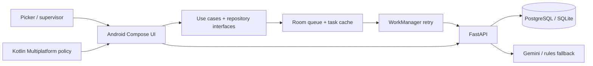

# PickSure

[](https://github.com/chaitanya-maddala-236/PickSure/actions/workflows/android.yml)

**Offline-first grocery picking with expiry-aware lot checks.** PickSure is an Android portfolio app for quick-commerce dark stores. A picker verifies both the requested product and its expiry-tracked lot before a pick is accepted. FEFO routing, a configurable shelf-life guard, offline event delivery, and an AI freshness advisor help reduce avoidable picking and stock-handling mistakes.

> PickSure is an independent portfolio project inspired by quick-commerce workflows. It is not affiliated with Blinkit and does not connect to Blinkit's systems.

## App demo

[▶ Watch the 12-second PickSure demo](screenshots/picksure-demo.mp4)

| Sign-in | Picker dashboard |
| --- | --- |
|  |  |

| Batch picking | Freshness advisor |
| --- | --- |
|  |  |

The images are captured from the Android emulator walkthrough. CI also builds an unsigned debug APK and publishes it with test reports as an artifact under [Actions](https://github.com/chaitanya-maddala-236/PickSure/actions/workflows/android.yml).

## Resume summary

**PickSure — Offline-First Grocery Fulfillment Android App** · Kotlin, Jetpack Compose, Kotlin Flow, Room, WorkManager, Kotlin Multiplatform, CameraX, ML Kit, FastAPI, Gemini

- Built a native picker and supervisor workflow for **3 demo orders / 6 order lines / 5 grocery SKUs**, with aisle-based batch routing, barcode checks, lot QR verification, packing, and review screens.
- Implemented FEFO lot selection and a configurable minimum-shelf-life guard across Android and the API, with lot traceability and transactional inventory updates.
- Added offline pick recording with Room, Kotlin Flow, repository/use-case layers, WorkManager retries, and UUID-idempotent server acknowledgments.
- Built a backend Gemini freshness advisor with validated, lot-grounded recommendations and a deterministic rules fallback; recommendations require staff review and do not change inventory.
- Added **11 automated test cases** across Android, shared Kotlin, backend, and emulator UI flows; CI builds the debug APK and captures the app walkthrough.

## Project metrics

| Seeded demo scenario | Count |
| --- | ---: |
| Assigned orders | 3 |
| Order lines | 6 |
| Grocery SKUs | 5 |
| Expiry-tracked lots | 10 (2 per SKU) |
| Starting inventory | 60 units |
| Dispatchable under the example policy | 50 units |
| Held by the example shelf-life rule | 10 units |
| Demo roles | 2 (picker and supervisor) |
| Scans before a pick is accepted | 2 (product barcode and lot QR) |
| Automated test cases in the project | 11 (2 Android, 5 shared KMP, 3 backend, 1 emulator UI) |

Inventory figures describe the seeded portfolio scenario. They are not production throughput or measured waste-reduction results.

## The problem and product flow

Quick-commerce pickers work to short delivery windows, move through store shelves, and can lose connectivity. Matching the product barcode alone does not guarantee a suitable expiry lot. PickSure adds a second verification and enforces the configured shelf-life policy before the backend accepts a pick.

1. A picker signs in and opens an assigned batch.
2. The shared Kotlin route planner groups work by aisle, rack, and shelf.
3. A product barcode must match the requested SKU.
4. The picker scans the lot QR. Android checks cached shelf-life policy; the API rechecks the lot, FEFO recommendation, quantity, and assignment.
5. Room saves a UUID event locally. WorkManager retries delivery when connectivity returns, and the API acknowledges events idempotently.
6. A supervisor reviews short-dated and expired lots, substitution requests, and sync exceptions.

## AI freshness advisor

The advisor reviews store inventory facts such as SKU, lot code, expiry date, quantity, and status. Gemini runs on the backend; its key is never embedded in the Android app. The server validates model output against real lot codes and permitted actions. Expired lots can only receive a quarantine-review suggestion. If Gemini is not configured or unavailable, the app uses clearly labeled deterministic rules. Suggestions require staff review and never modify stock.

## Architecture and technology



| Layer | Implementation |
| --- | --- |
| Android | Kotlin, Jetpack Compose, Material 3 |
| Architecture | Data/domain boundaries, repository interfaces, use cases |
| Reactive/offline | Kotlin Flow, Coroutines, Room, WorkManager |
| Scanning | CameraX and Google ML Kit barcode scanning |
| Shared code | Kotlin Multiplatform freshness policy and shelf route planner; Android and iOS targets declared |
| API | FastAPI, SQLAlchemy, JWT, Alembic |
| Database | PostgreSQL in Docker Compose; SQLite for local development and CI |
| AI | Backend Gemini integration with validated output and deterministic fallback |
| Crash reporting | Firebase Crashlytics integration, enabled when a developer supplies the app configuration |

Offline delivery is at least once. Server-side UUID idempotency ensures an accepted event is applied once logically; rejected events remain available for review.

## Tests and build

The repository includes 11 automated test cases: 2 Android JVM tests, 5 shared Kotlin tests, 3 backend tests, and 1 Compose emulator flow. The GitHub Actions workflow runs the backend, Android, and shared Kotlin suites, builds the debug and instrumentation APKs, and runs the UI walkthrough on an Android emulator.

```powershell
# Backend tests (from backend/)
python -m unittest discover -s tests -v

# Android and shared Kotlin tests / debug APK (from android/)
.\gradlew.bat :app:testDebugUnitTest :shared:testDebugUnitTest :app:assembleDebug

# Emulator UI test (requires a running seeded API and Android emulator)
.\gradlew.bat :app:connectedDebugAndroidTest
```

The emulator reaches a host API at `http://10.0.2.2:8000/api/v1/`. CI starts a seeded API for the walkthrough and captures the sign-in, dashboard, batch, and advisor screens.

## Run locally

### Start the API and database

From the repository root:

```powershell
Copy-Item .env.example .env
docker compose up --build
```

The API runs at `http://127.0.0.1:8000`; interactive API docs are at `http://127.0.0.1:8000/docs`.

| Role | Email | Password |
| --- | --- | --- |
| Picker | `picker@picksure.demo` | `PickSure123!` |
| Supervisor | `supervisor@picksure.demo` | `PickSure123!` |

The example policy requires **3 calendar days** remaining at dispatch. This is an adjustable demo setting.

### Build or open Android

Open the `android` folder in Android Studio, or run:

```powershell
cd android
.\gradlew.bat assembleDebug
```

The default emulator API URL is `http://10.0.2.2:8000/api/v1/`. For a physical device, set `API_BASE_URL` in `android/gradle.properties` to the development machine's LAN address. Local HTTP is enabled for this demo; use HTTPS for deployment.

### Optional integrations

- **Gemini:** Set `GEMINI_API_KEY` in the backend `.env`. `GEMINI_MODEL` defaults to `gemini-2.5-flash`. Keep the key on the backend; the rules fallback works without it.
- **Firebase Crashlytics:** Add a Firebase Android app config for package `com.picksure.android` at `android/app/google-services.json`, then rebuild. The local config is git-ignored; Gradle applies Google Services and Crashlytics when it is present.

## Design notes

- [Freshness First](docs/freshness-first.md)
- [Architecture](docs/architecture.md)
- [Offline synchronization](docs/offline-sync-design.md)
- [Barcode and lot workflow](docs/barcode-workflow.md)
- [API design](docs/api-design.md)
- [Database schema](docs/database-schema.md)
