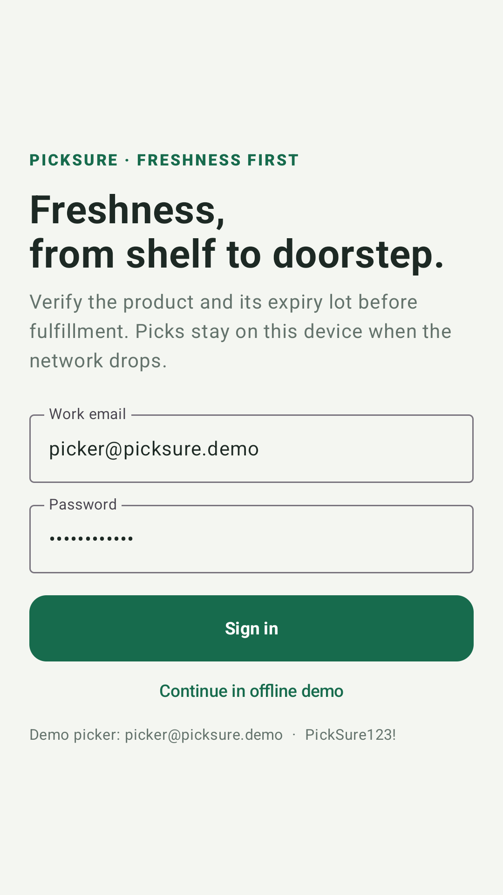
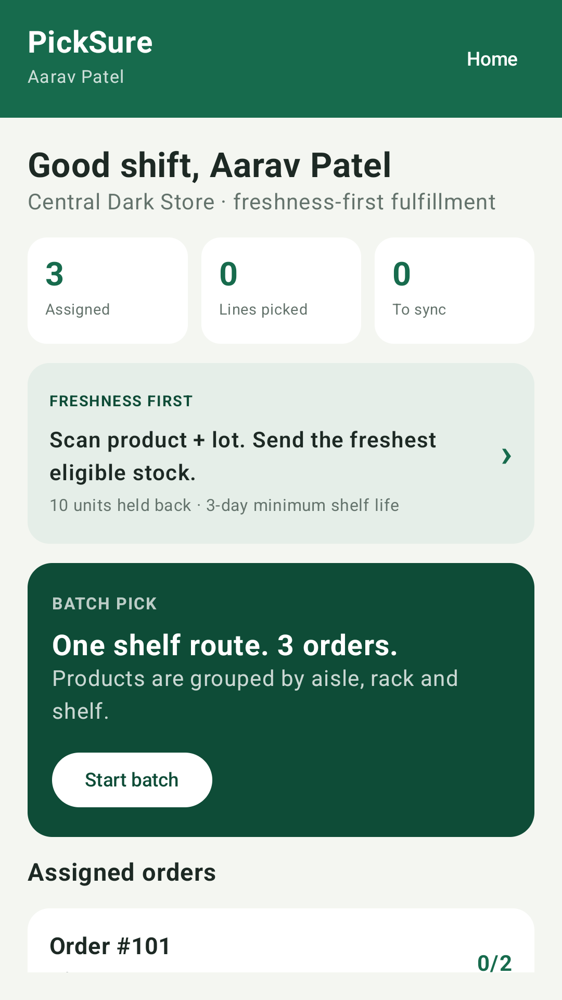
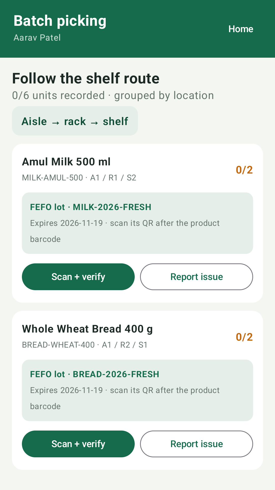
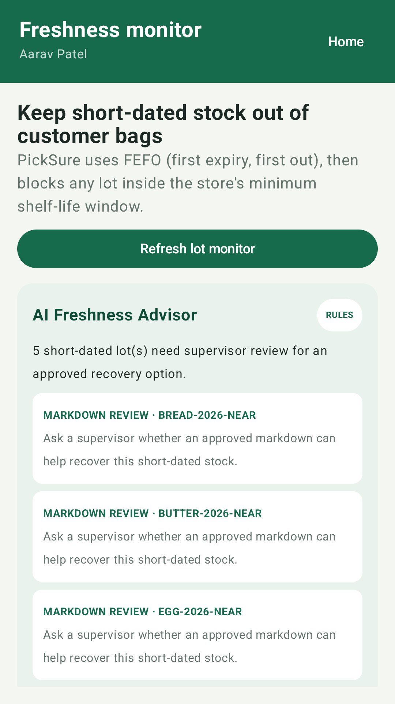
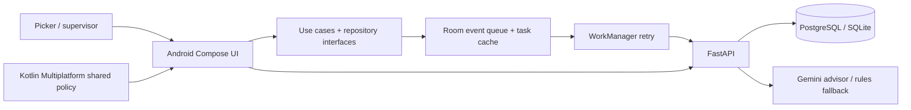

# PickSure

[](https://github.com/chaitanya-maddala-236/PickSure/actions/workflows/android.yml)

**Freshness-first picking for quick-commerce dark stores.** PickSure is a portfolio Android app for a real operational problem: a picker can choose the right grocery SKU but still select a lot that is too close to expiry. PickSure combines a product barcode scan with an expiry-lot QR, applies FEFO (first-expiry, first-out), and keeps picks safe to record when the network drops.

> Built as an independent portfolio project inspired by quick-commerce workflows. It is not affiliated with Blinkit and does not connect to Blinkit's systems.

## See the app

The Android emulator walkthrough captures the sign-in, picker dashboard, batch route, and freshness advisor. The short reel is generated from those real emulator screens in CI.

[▶ Watch the 12-second demo reel](screenshots/picksure-demo.mp4)

| Sign-in | Picker dashboard |
| --- | --- |
|  |  |

| Batch picking | Freshness and AI advisor |
| --- | --- |
|  |  |

The latest CI run also publishes a downloadable **unsigned debug APK** and test reports as a GitHub Actions artifact. It is for emulator/demo use, not a Play Store release. [Open CI runs and artifacts](https://github.com/chaitanya-maddala-236/PickSure/actions/workflows/android.yml).

## The real-world problem and approach

Quick-commerce pickers work against short delivery windows, move across a store shelf by shelf, and may lose network connectivity. Wrong-product scans, short-dated lots, and unacknowledged offline picks can each create fulfillment problems.

PickSure addresses this with a two-scan workflow, store-configured minimum shelf life, FEFO lot selection, a Room-backed event queue, and per-event server acknowledgments. A freshness advisor suggests review actions for short-dated stock. It can use Gemini on a server-side API key; when that key is absent or unavailable, deterministic rules keep the advisor useful. Recommendations never modify stock and must be reviewed by store staff.

## Demo data in numbers

| Seeded portfolio scenario | Count |
| --- | ---: |
| Assigned orders | 3 |
| Order lines | 6 |
| Grocery SKUs | 5 |
| Expiry-tracked lots | 10 (2 per SKU) |
| Starting inventory | 60 units |
| Dispatchable at seed | 50 units |
| Held back by the example shelf-life policy | 10 units |
| Employee roles | 2 (picker and supervisor) |
| Scans required for a pick | 2 (product barcode and lot QR) |
| Automated test cases | 11 (2 Android unit, 5 shared KMP, 3 backend, 1 emulator UI flow) |

These are seed and test-scope counts, not production throughput, savings, or measured waste reduction.

## Product workflow

1. Sign in as a picker and open an assigned batch.
2. Follow the aisle/rack/shelf route. The route planner is shared Kotlin code used by Android.
3. Scan the requested product barcode; a mismatch cannot create a pick.
4. Scan the recommended lot QR. The app checks the cached shelf-life rule and the API rechecks the lot, FEFO recommendation, quantity, and assignment.
5. Room saves a UUID event before the app reports that the pick is locally saved. WorkManager retries when a network is available.
6. A supervisor reviews short-dated and expired lots, substitution requests, and sync exceptions.

The **AI Freshness Advisor** receives only store inventory facts (SKU, lot, expiry date, quantity, and status). The Gemini key stays on the backend. Model output is checked against actual lot codes and allowed actions; expired lots can only receive a quarantine-review suggestion. Without Gemini configuration or when the provider fails, the advisor displays clearly labeled rule-based suggestions.

## Architecture and stack



| Area | Implementation |
| --- | --- |
| Android UI | Kotlin, Jetpack Compose, Material 3 |
| Scanning | CameraX, Google ML Kit barcode scanning |
| App structure | Data, domain models, repository interface, and use cases |
| Offline work | Room, Kotlin Flow, Coroutines, WorkManager |
| Shared logic | Kotlin Multiplatform module with freshness policy and shelf route planner; Android and iOS targets declared |
| API | FastAPI, SQLAlchemy, JWT, Alembic |
| AI | Gemini API called by the backend; deterministic fallback; no key embedded in the app |
| Data | PostgreSQL in Docker Compose; SQLite for local development and CI |
| Firebase | Crashlytics records sanitized non-fatal operation failures when a Firebase `google-services.json` is supplied |

Offline delivery is at least once. Server UUID idempotency ensures an accepted event is applied once logically; rejected events remain available for review.

## Tests and evidence

GitHub Actions installs the backend dependencies, runs three backend advisor tests, starts a seeded API, and runs Android unit tests, shared KMP tests, and a Compose UI walkthrough on an API 34 emulator. The UI walkthrough signs in, visits batch picking and the freshness advisor, and saves the four screenshots used above. CI builds an unsigned debug APK and uploads reports and the APK artifact.

```powershell
# Backend tests (from backend/)
python -m unittest discover -s tests -v

# Android and shared Kotlin tests / APK (from android/)
.\gradlew.bat :app:testDebugUnitTest :shared:testDebugUnitTest :app:assembleDebug

# Emulator UI walkthrough (requires a running seeded API and Android emulator)
.\gradlew.bat :app:connectedDebugAndroidTest
```

The UI walkthrough expects the API at `http://10.0.2.2:8000/api/v1/` from the Android emulator. CI configures and starts that API for the test. Local screenshots are not fabricated or checked in by hand; the repository images come from the emulator test.

## Run the demo locally

### 1. Start the backend and database

From the repository root:

```powershell
Copy-Item .env.example .env
docker compose up --build
```

The API is at `http://127.0.0.1:8000` and its docs at `http://127.0.0.1:8000/docs`.

| Role | Email | Password |
| --- | --- | --- |
| Picker | `picker@picksure.demo` | `PickSure123!` |
| Supervisor | `supervisor@picksure.demo` | `PickSure123!` |

The default example policy requires **3 calendar days** remaining at dispatch. It is an adjustable demo setting, not universal food-safety or legal guidance.

To turn on Gemini, set `GEMINI_API_KEY` in the local `.env` used by Docker Compose. `GEMINI_MODEL` defaults to `gemini-2.5-flash`. Keep the key on the backend; never add it to Android resources or `gradle.properties`. The rules fallback works without a key.

### 2. Build or open Android

Open the `android` folder in Android Studio, or run:

```powershell
cd android
.\gradlew.bat assembleDebug
```

The default emulator API URL is `http://10.0.2.2:8000/api/v1/`. For a physical device, set `API_BASE_URL` in `android/gradle.properties` to the development machine's LAN address. Local HTTP is enabled for this demo; use HTTPS for a deployment.

### Optional Firebase Crashlytics setup

Create a Firebase Android app for package `com.picksure.android`, place its `google-services.json` at `android/app/google-services.json`, then rebuild. That local file is git-ignored. Gradle applies Google Services and Crashlytics only when the file exists. This repository includes the SDK integration and sanitized login-failure reporting, but no Firebase project credentials or production telemetry configuration.

## Resume-ready summary

**PickSure — Offline-First Grocery Fulfillment Android App** · Kotlin, Jetpack Compose, Kotlin Flow, Room, WorkManager, KMP, CameraX, ML Kit, FastAPI, Gemini

- Built a native picker workflow for **3 demo orders / 6 lines / 5 grocery SKUs**, with aisle-based batch routing, barcode checks, lot QR verification, packing, and supervisor review.
- Implemented FEFO lot selection and a configurable shelf-life guard across Android and backend, with lot traceability and transactional inventory updates.
- Designed offline event recording with Room, Kotlin Flow, repository/use-case layers, WorkManager retries, and UUID-idempotent server acknowledgments.
- Added a backend Gemini freshness advisor with a validated, rule-based fallback; recommendations are lot-grounded, staff-reviewed, and do not modify inventory.
- Added **11 automated test cases** across Android unit, shared KMP, backend, and emulator UI flows; CI builds a debug APK and captures demo screens.

Only the seeded scenario counts are quantified here. No user study, waste reduction, pick-time improvement, production deployment, Blinkit integration, or Play Store publication is claimed.

## Scope and limitations

The store, employees, tasks, inventory, and shelf locations are seeded demo data. The shelf route groups by aisle/rack/shelf; it is not a warehouse-optimization engine. Gemini integration requires the developer to provide a backend API key. Crashlytics requires a developer-owned Firebase app configuration. The repository does not contain a signed release APK or Play Store listing.

## Design notes

- [Freshness First](docs/freshness-first.md)
- [Architecture](docs/architecture.md)
- [Offline synchronization](docs/offline-sync-design.md)
- [Barcode and lot workflow](docs/barcode-workflow.md)
- [API design](docs/api-design.md)
- [Database schema](docs/database-schema.md)
