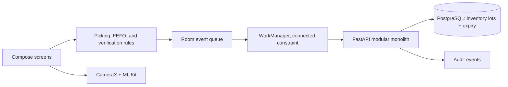

# Architecture

## Android

The MVP is kept in one Gradle app module and organized by responsibility under `data/local`, `data/remote`, `data/sync`, and `ui`. This keeps the demo build small while retaining clear boundaries; the PRD module map can be split out as the feature set grows. Compose owns screen state, CameraX binds to the lifecycle, and ML Kit decodes product barcodes and lot QR tags. Room caches the last task/item snapshot and stores immutable event identity, lot trace, and delivery state. WorkManager drains events when network connectivity is available.

## Backend

FastAPI routers split authentication, tasks, scans, inventory freshness, sync, packing, and audit access. SQLAlchemy models map the operational schema. PostgreSQL is used by Docker Compose; SQLite supports local API development. The FEFO service filters expired and too-near-expiry lots, and accepted picks decrement both the selected lot and aggregate SKU inventory in one transaction. Every sync UUID has a unique constraint and each event is handled in its own commit so a bad event does not roll back successful neighbors.

## Access control

JWTs identify an active employee. Pickers can access assigned tasks at their store. Supervisors and admins can inspect store tasks and audit logs. All mutations re-check the employee and store on the server; Android validation improves feedback but is not authoritative.
