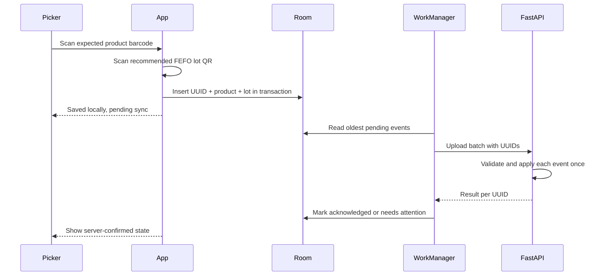

# Offline synchronization

The Room insert completes before the success state is shown. A connectivity-constrained WorkManager request sends up to 50 events in creation order. Transport failures keep events pending and retry with WorkManager backoff. An accepted response marks only that UUID synced. A validation rejection moves only that UUID to `NEEDS_ATTENTION`; the event and error remain available, and the picker can explicitly retry after reviewing it. If no employee token is stored, events remain pending until sign-in schedules work.

The server stores each UUID under a unique constraint and commits each event separately. The synchronization guarantee is exactly-once logical application through idempotency, not exactly-once network delivery.
